# Digital Forensics Lab Report
## Creating, Deleting and Recovering Evidence with The Sleuth Kit on Kali Linux

## Table of Contents
1. Abstract
2. Introduction
3. Background Knowledge
4. Objectives
5. Scenario
6. Lab Environment and Tools
7. Methodology and Procedure (Parts 1 to 7)
8. Results Summary
9. Analysis and Discussion
10. Answers to Review Questions
11. Limitations
12. Conclusion
13. References

---

## 1. Abstract

In this lab I built a 200 MB NTFS disk image, placed 8 files of different types on it, and then deleted them. Acting as an investigator, I used The Sleuth Kit (TSK) to find the partition, list the deleted files, read their metadata, and recover them. All 8 files were recovered. Each recovered file was checked with a SHA-256 hash, and all 8 hashes matched the originals. The hash of the evidence image was the same before and after the investigation, which proved that the evidence was not changed.

---

## 2. Introduction

Digital forensics is the process of finding, keeping, studying and presenting digital evidence in a way that can be trusted. One common task is recovering files that a suspect has deleted. Many people believe that a deleted file is gone forever, but this is usually not true. When a file is deleted, the file system normally marks the file's space as free and leaves the data on the disk until new data overwrites it.

The Sleuth Kit is a free, open-source set of command-line tools that reads disk images and file systems without changing them. This makes it suitable for forensic work, because the original evidence must stay untouched.

This report describes a hands-on practical in which I created my own evidence, deleted it, and then recovered it using TSK. Building the evidence myself meant that I knew exactly which files existed, so I could prove that the recovery was correct by comparing hashes.

---

## 3. Background Knowledge

**Disk image.** A disk image is an exact file copy of a drive. In this lab the image was a raw (dd) file called `evidence.dd`.

**Partition and offset.** A disk can be divided into partitions. A partition is a region that starts at a certain sector inside the image. This starting sector is called the offset. In this lab the NTFS partition started at sector 2048 (2048 x 512 bytes = 1 MiB). TSK needs this value with the `-o` option for every file system command.

**NTFS and the MFT.** NTFS is the Windows file system. Its Master File Table (MFT) stores a 1,024-byte entry for every file. Each entry holds the file name, timestamps, and the location of the data.

**Resident and non-resident data.** Small files are stored inside the MFT entry itself. These are called resident files. Larger files are stored in clusters outside the MFT, and the MFT entry only points to them. These are called non-resident files.

**Cluster.** A cluster is the smallest unit of file data. In this lab it was 4,096 bytes (8 sectors).

**What deletion does.** When a file is deleted on NTFS, its MFT entry and clusters are marked as free, but the bytes remain on the disk until they are overwritten.

**Hashing.** A SHA-256 hash is a 64-character fingerprint of data. If even one bit changes, the hash changes completely. Hashes are used to prove that a recovered file is identical to the original, and that evidence has not been altered.

**TSK layer model.** TSK works in layers: image, then partition, then file system, then file name, then metadata, then content. Each tool in this lab belonged to one of these layers.

| Layer | Question | Tool used |
|---|---|---|
| Image | What is this image? | `img_stat` |
| Partition | How is the disk divided? | `mmls` |
| File system | Which file system, and how is it laid out? | `fsstat` |
| File name | Which files exist or were deleted? | `fls`, `ffind` |
| Metadata | What do we know about one file? | `istat` |
| Content | What is inside the file? | `icat`, `blkcat`, `tsk_recover` |

---

## 4. Objectives

By the end of this lab I was able to:

1. Install and verify The Sleuth Kit on Kali Linux.
2. Explain the TSK layer model.
3. Use `img_stat`, `mmls`, `fsstat`, `fls`, `istat`, `icat`, `ffind` and `tsk_recover`.
4. Find a partition offset and use it with `-o`.
5. Recover deleted files and verify them with SHA-256 hashes.
6. Build a simple file-activity timeline with `fls -m` and `mactime`.

---

## 5. Scenario

A USB drive was seized from a Finance employee who was suspected of leaking "Project Falcon" data. Before the drive was seized, the suspect deleted a report, a photo, a contract, a password list and other files. My job as the investigator was to analyse the drive image, find the deleted files, examine their metadata, recover them, and prove that the recovered files were unaltered.

Parts 2 to 4 of the lab played the role of the suspect. From Part 5 onwards I acted as the investigator, and I never mounted or modified `evidence.dd` again.

---

## 6. Lab Environment and Tools

**Environment:** Kali Linux virtual machine with sudo rights. The image was 200 MB and was attached as the loop device `/dev/loop11`.

| Tool | Purpose |
|---|---|
| `dd` | Created the blank 200 MB image |
| `parted` | Created the partition table |
| `losetup` | Attached the image as a loop device |
| `mkfs.ntfs` / `mount` | Formatted and mounted the NTFS partition |
| `python3` | Ran the script that created the sample files |
| `file` | Identified file types by content |
| `sha256sum` | Created and checked hashes |
| `img_stat`, `mmls`, `fsstat` | Studied the image, partitions and file system |
| `fls`, `ffind`, `istat` | Listed files and read metadata |
| `icat`, `blkcat`, `tsk_recover` | Recovered file content |
| `mactime` | Built the timeline |

---

## 7. Methodology and Procedure

### Part 1: Install The Sleuth Kit

I installed `sleuthkit`, `ntfs-3g`, `parted`, `file` and `python3` with `apt`. I then checked the installation with `mmls -V` and `which`. TSK version 4.14.0 was installed, and all 8 required tools were found in `/usr/bin`. I created the working folder `~/tsk_lab`.

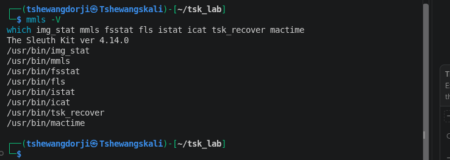

---

### Part 2: Build the Evidence Image

In this part I acted as the suspect and built a fake USB drive.

**Step 2.1: Create a blank 200 MB image.** I used `dd` to create `evidence.dd` filled with zeros. It copied 209,715,200 bytes.

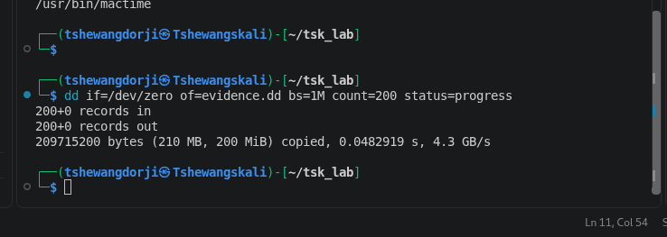

**Step 2.2: Write the partition table.** I used `parted` to create an MBR partition table with one partition. The partition started at sector 2048 and ended at sector 409599.

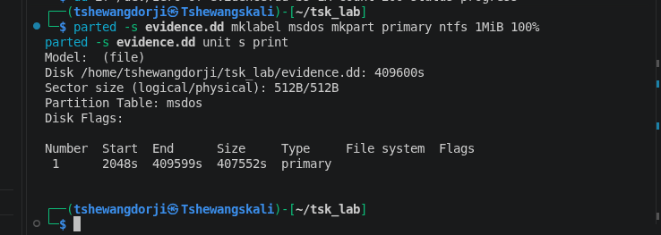

**Step 2.3: Attach the image as a loop device.** I used `losetup`. The image was attached as `/dev/loop11`, and the partition appeared as `/dev/loop11p1`.

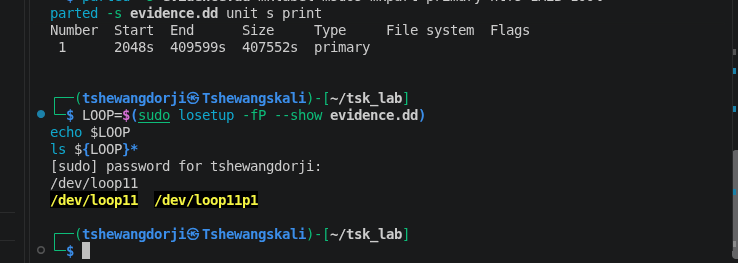

**Step 2.4: Format the partition as NTFS.** I used `mkfs.ntfs` with the label EVIDENCE. It finished with "mkntfs completed successfully". The warnings about start sector and heads only matter when booting Windows, so I ignored them.

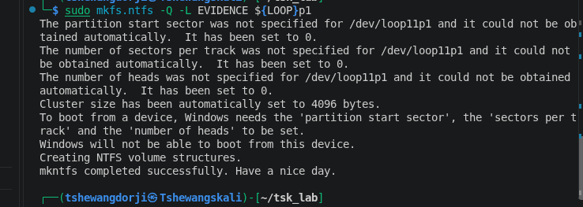

**Step 2.5: Mount the drive.** I mounted the partition at `/mnt/evidence`. The `df -h` command showed 199M total and 2% used, so the drive was empty and ready.

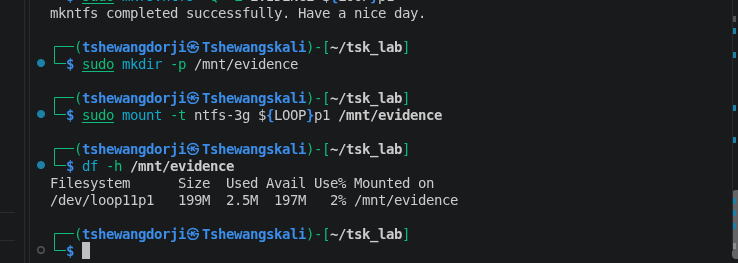

---

### Part 3: Plant Files of Different Types and Hash Them

**Step 3.1: Create the generator script.** I created a Python script called `make_files.py` that builds 9 sample files.

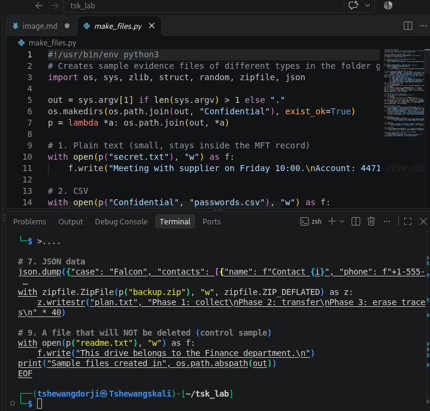

**Step 3.2: Run the script.** The script created these files on the mounted drive:

| Location | Files |
|---|---|
| Root folder | `secret.txt`, `report.pdf`, `photo.png`, `notes.html`, `backup.zip`, `readme.txt` |
| `Confidential` folder | `passwords.csv`, `contract.docx`, `contacts.json` |

The file `readme.txt` was a control sample. I did not delete it.

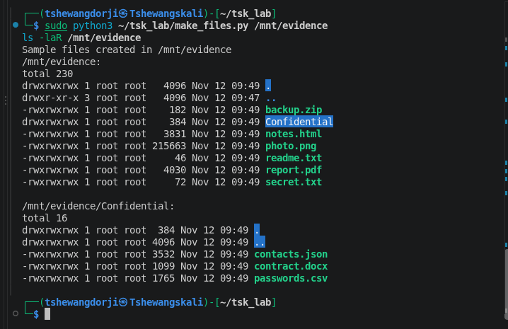

**Step 3.3: Confirm the file types.** I used the `file` command to check each file by its content. Every file was identified correctly as PDF, PNG, ZIP, Word, JSON, CSV, HTML or text.

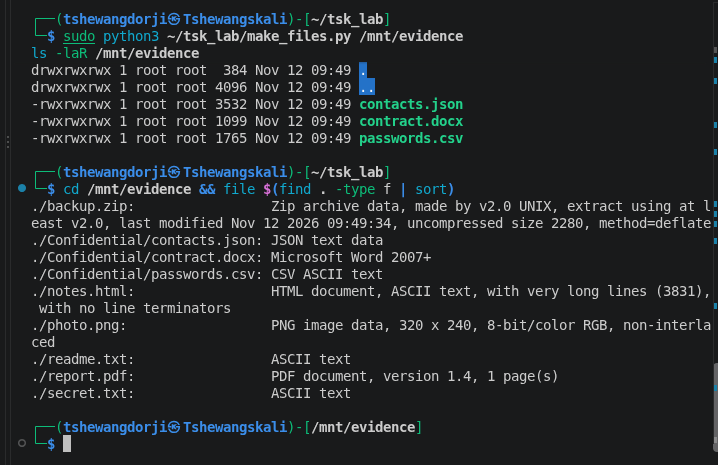

**Step 3.4: Record the original hashes.** I saved the SHA-256 hashes of the 8 files (all except `readme.txt`) in `original_hashes.txt`. These hashes were the ground truth for checking recovery later.

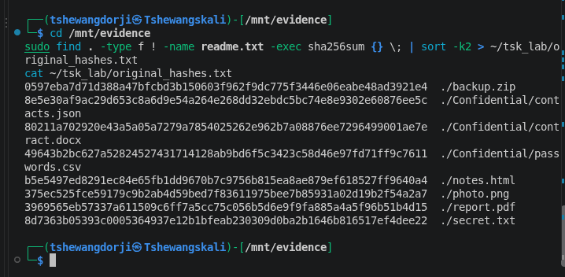

---

### Part 4: Delete the Files and Seal the Image

**Step 4.1: Delete the files.** I deleted 5 files in the root folder and the whole `Confidential` folder. Only `readme.txt` remained.

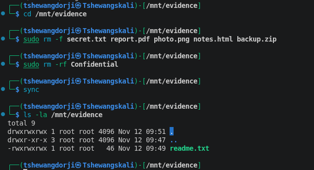

**Step 4.2: Unmount and detach.** I unmounted the drive and detached the loop device. The image no longer appeared in `losetup -a`.

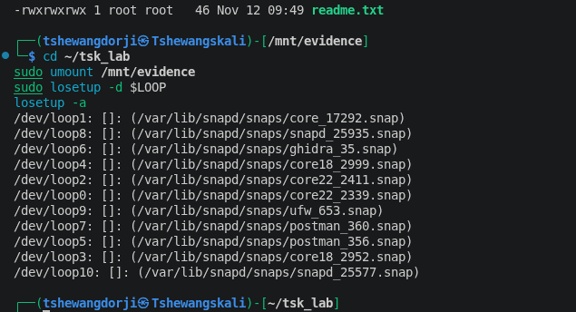

**Step 4.3: Hash the image (acquisition hash).** I calculated the SHA-256 hash of `evidence.dd` and saved it in `evidence.dd.sha256`:

`1f52e6e391985cd8228f48fde220108db842d8c620526dabb716c86c9d43d07d`

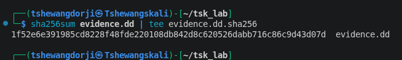

**Step 4.4: Make the image read-only.** I used `chmod 444` so the image could not be changed. This worked as a simple software write-protect. In a real case, a hardware write-blocker would also be used when imaging a physical drive.

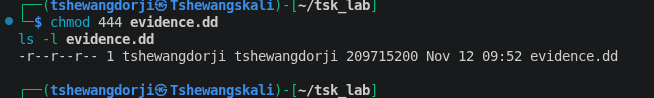

---

### Part 5: Investigate the Image with TSK

In this part I acted as the investigator. I only read the image with TSK. I did not need `sudo` and I did not mount the image.

**Step 5.1: Verify the evidence.** Before starting, I ran `sha256sum -c evidence.dd.sha256`. It printed `evidence.dd: OK`, so the image was the same as the one that was acquired.

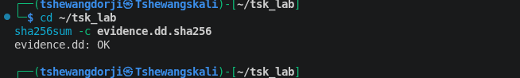

**Step 5.2: img_stat (what is this image?).** The image type was raw, the size was 209,715,200 bytes, and the sector size was 512 bytes.

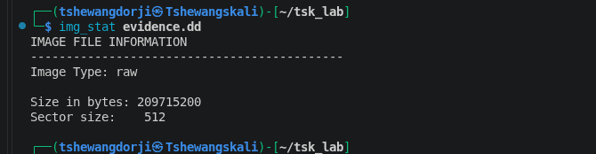

**Step 5.3: mmls (how is the disk divided?).** The partition table showed:

| Slot | Start | End | Length | Description |
|---|---|---|---|---|
| 000 Meta | 0 | 0 | 1 | Primary partition table |
| 001 | 0 | 2047 | 2048 | Unallocated (alignment gap) |
| 002 | **2048** | 409599 | 407552 | NTFS / exFAT (0x07) |

The NTFS partition started at sector **2048**, so I used `-o 2048` in all later commands.

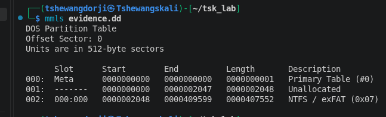

**Step 5.4: fsstat -t (which file system?).** The result was `ntfs`.

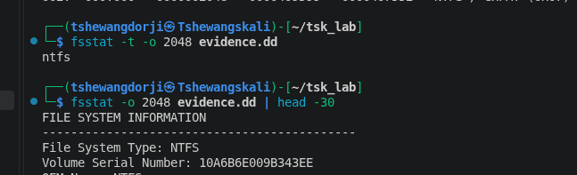

**Step 5.5: fsstat (how is the file system laid out?).** The key values were:

| Item | Value |
|---|---|
| File system type | NTFS |
| Volume name | EVIDENCE |
| MFT entry size | 1024 bytes |
| MFT range | 0 to 74 (75 entries) |
| Root directory | MFT entry 5 |
| Cluster size | 4096 bytes |

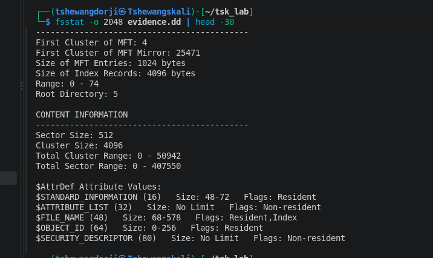

**Step 5.6: fls (what files exist now?).** This listed the root folder. `readme.txt` had no `*`, so it was still allocated. The entries marked with `*` were deleted: Confidential, secret.txt, report.pdf, photo.png, notes.html and backup.zip.

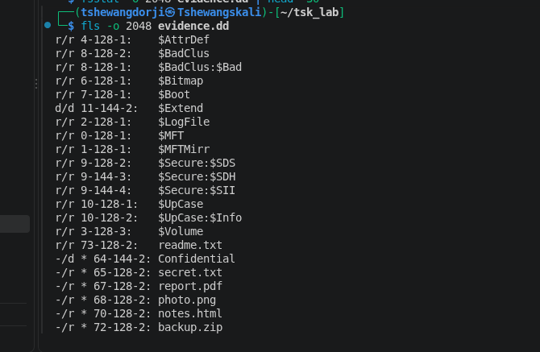

**Step 5.7: fls -r -d -p (list every deleted file).** This listed all deleted files, including those inside the deleted folder:

| MFT entry | Deleted file |
|---|---|
| 64 | Confidential (folder) |
| 65 | secret.txt |
| 66 | Confidential/passwords.csv |
| 67 | report.pdf |
| 68 | photo.png |
| 69 | Confidential/contract.docx |
| 70 | notes.html |
| 71 | Confidential/contacts.json |
| 72 | backup.zip |

The `OrphanFile-16` to `OrphanFile-23` entries were reserved, never-used MFT entries, so I ignored them.

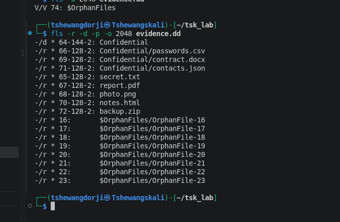

**Step 5.8: istat (examine a deleted file's metadata).** For `report.pdf` (entry 67), the output showed:

- **Not Allocated File** and **Links: 0**, which confirmed the deletion.
- **Parent MFT Entry: 5**, which meant the file was in the root folder.
- **$DATA Non-Resident, size 4030**, stored at cluster **25984**.
- The timestamps were shown in EST.

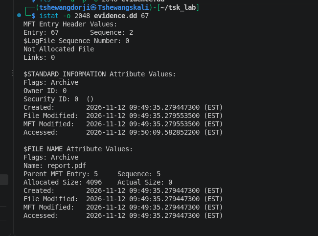

I then compared this with `secret.txt` (entry 65). Its `$DATA` attribute was **Resident** with a size of 72 bytes, which meant its content was stored inside the MFT entry itself.

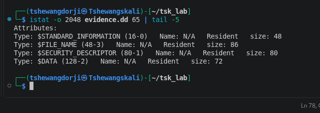

---

### Part 6: Recover Every Deleted File and Verify It

**Step 6.1: View the small text file.** I ran `icat -r` on entry 65. The deleted note was fully readable on the screen:

> Meeting with supplier on Friday 10:00. Account: 4471-2290. Do not share.

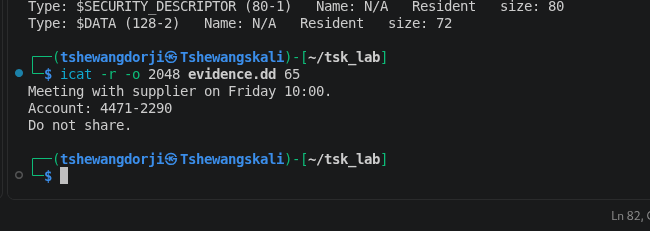

**Step 6.2: Read the raw cluster.** I ran `blkcat` on cluster 25984. The output started with `%PDF-1.4`, which showed that the file's bytes were still on the disk after deletion.

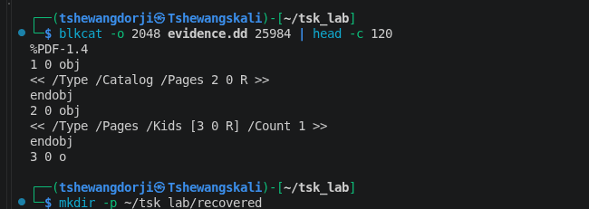

**Step 6.3: Recover the PDF.** I recovered `report.pdf` with `icat -r`. The size was 4030 bytes, the same as the `$DATA` size from `istat`. The `file` command identified it as a PDF document, version 1.4.

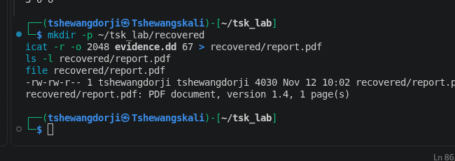

**Step 6.4: Recover the other 7 files.** I ran `icat -r` once for each MFT entry (65, 66, 68, 69, 70, 71, 72). All file sizes matched the originals.

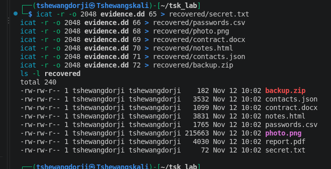

**Step 6.5: Confirm the file types.** The `file` command showed the correct type for every recovered file, the same as before deletion. This proved the content was correct and not just the name.

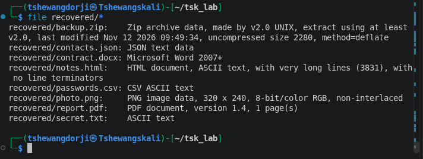

**Step 6.6: Prove recovery with hashes.** I checked the recovered files against `original_hashes.txt`. All 8 files showed **OK**. I saved the new hashes in `recovered_hashes.txt`.

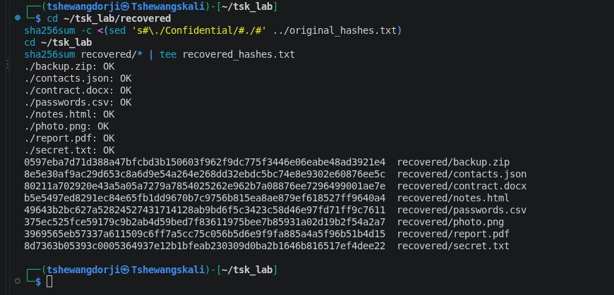

---

### Part 7: Bulk Recovery, Timeline and Final Integrity Check

**Step 7.1: tsk_recover.** I recovered all deleted files with one command. It printed `Files Recovered: 8` and kept the `Confidential` folder structure. `readme.txt` was not included, because `tsk_recover` only exports deleted files by default.

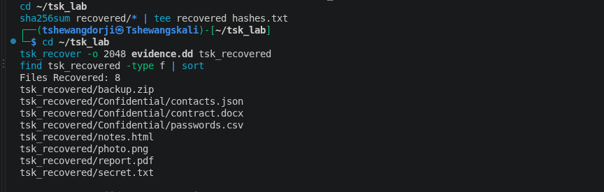

Because the folder structure was kept, I checked the files against the original hash list directly. All 8 files were **OK** again.

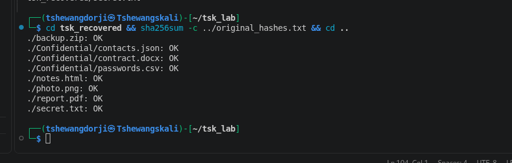

**Step 7.2: Build a timeline.** I used `fls -r -m` to create a body file and `mactime` to create `timeline.csv`. The timeline showed three groups of events (times in UTC):

| Time (UTC) | Type | Meaning |
|---|---|---|
| 14:49:35 | `m.cb` / `.a.b` | All files were created and modified (when the Python script ran) |
| 14:50:09 | `.a..` | All files were accessed (when the original hashes were calculated) |
| 14:51:58 | `m.c.` | The `Confidential` folder was modified and its MFT entry changed (when its files were deleted) |

In the Type column, `m` means modified, `a` means accessed, `c` means MFT entry changed, and `b` means born (created).

The timeline used UTC, while `istat` had shown EST. Both showed the same moment, five hours apart. The "Old package separator" warnings from `mactime` were harmless.

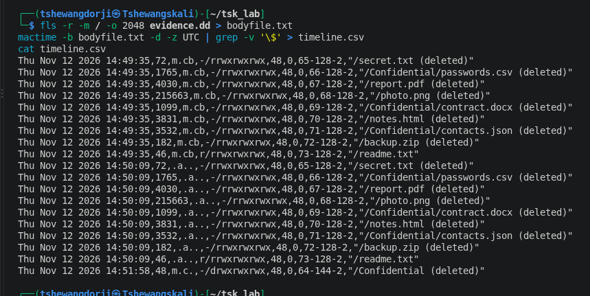

**Step 7.3: Final integrity check.** I ran `sha256sum -c evidence.dd.sha256` again. It printed `evidence.dd: OK`, so the image was not changed by my investigation.

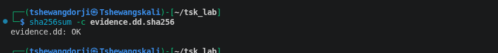

---

## 8. Results Summary

| Item | Result | Command used |
|---|---|---|
| TSK version | 4.14.0 | `mmls -V` |
| Image SHA-256 (before) | `1f52e6e391985cd8228f48fde220108db842d8c620526dabb716c86c9d43d07d` | `sha256sum` |
| Image type and size | raw, 209,715,200 bytes | `img_stat` |
| Partition start sector (offset) | 2048 | `mmls` |
| File system and volume name | NTFS, EVIDENCE | `fsstat` |
| Cluster size / MFT entry size | 4096 bytes / 1024 bytes | `fsstat` |
| Number of deleted files found | 8 files and 1 folder | `fls -r -d -p` |
| MFT entry of report.pdf | 67 | `fls` |
| report.pdf created time | 2026-11-12 09:49:35 EST (14:49:35 UTC) | `istat` |
| report.pdf data cluster | 25984 | `istat` |
| Files recovered / hashes matching | 8 / 8 | `icat`, `sha256sum -c` |
| Time the Confidential folder was emptied | 14:51:58 UTC | `mactime` |
| Image SHA-256 (after) matches? | Yes (OK) | `sha256sum -c` |

---

## 9. Analysis and Discussion

**Why recovery worked.** Deleting the files only marked their MFT entries and clusters as free. Nothing was written to the image after deletion, so the data was never overwritten. This is why all 8 files were recovered with 100% matching hashes.

**Resident and non-resident files.** `secret.txt` was only 72 bytes, so NTFS stored it inside its MFT entry (resident). `report.pdf` was 4,030 bytes, so it was stored in cluster 25984 (non-resident). Both survived deletion, but they were stored in different places.

**File names and content are separate.** `icat` recovered every file using only the MFT entry number. The file names came from `fls`, and I chose the output names myself. This showed that the name and the content are stored in different places.

**Hashes as proof.** Opening a recovered file only shows that it looks correct. A matching SHA-256 hash proves that every bit is identical to the original. I also used hashes to show that the evidence image did not change during the investigation.

**Timeline findings.** The timeline showed that all files were created at the same time (14:49:35 UTC). The files were accessed at 14:50:09 UTC, when I calculated the original hashes. The `Confidential` folder was then changed at 14:51:58 UTC, which was about 1 minute 49 seconds after the hashing and about 2 minutes 23 seconds after the files were created. That last event marked the moment the folder's contents were deleted. A timeline like this helps an investigator rebuild what happened and when.

**Time zones.** `istat` showed EST and `mactime` was set to UTC. This showed why investigators always fix the time zone when they report times.

---

## 10. Answers to Review Questions

**1. Why does `fsstat evidence.dd` fail without `-o`, and where does 2048 come from?**
Sector 0 of the image holds the partition table, not a file system, so TSK cannot find a file system there. The value 2048 comes from `mmls`, which showed that the NTFS partition starts at sector 2048 (1 MiB divided by 512 bytes).

**2. What do `*` and `-/r` mean in `-/r * 67-128-2: report.pdf`?**
The `*` means the file is deleted. The `-/r` shows the type from the directory entry and from the MFT entry: `-` means the directory entry type is unknown (because it was deleted) and `r` means the MFT entry says it was a regular file.

**3. What is the difference between resident and non-resident, and how did `istat` show it?**
A resident file has its content stored inside the MFT entry. A non-resident file has its content stored in clusters outside the MFT. `istat` showed `Resident size: 72` for `secret.txt`, and `Non-Resident size: 4030` with cluster 25984 for `report.pdf`.

**4. How did `icat` recover files without knowing their names?**
The content is found through the MFT entry number, not the file name. The MFT entry holds the `$DATA` attribute, which points to the data. The name is stored separately.

**5. Why compare SHA-256 hashes instead of just opening the files?**
A file can open and look normal even if some bytes are wrong. A matching hash proves that the recovered file is identical to the original, bit for bit.

**6. Give two reasons a deleted file might not be recoverable on a real drive.**
First, new files can reuse the freed clusters and overwrite the data. Second, new files can reuse the MFT entry, which destroys the name and the pointer to the data. SSD TRIM can also erase freed blocks automatically.

**7. What does the final `sha256sum -c evidence.dd.sha256` prove, and why does it matter in court?**
It proves that the image was exactly the same at the end as when it was acquired, so the analysis did not change it. In court, this shows the evidence is reliable and has not been tampered with.

---

## 11. Limitations

- The recovery was 100% successful because the image was created in a controlled lab and nothing was written after deletion. On a real drive in use, files may be partly or fully overwritten.
- The image was protected only by a software read-only setting. Real cases use hardware write-blockers.
- The extension task (overwriting the data with a filler file) was not part of this report.
- The MFT numbers, cluster numbers and times were specific to my run and may differ on other systems.

---

## 12. Conclusion

In this lab I built an NTFS disk image, created 8 files of different types, and deleted them. I then used The Sleuth Kit to find the partition offset (2048), identify the file system, list the deleted files, read their metadata, and recover them. All 8 files were recovered, and every SHA-256 hash matched the original. A timeline showed when the files were created, accessed and deleted. The hash of `evidence.dd` was the same at the start and at the end, which proved that the evidence was never changed.

The lab showed that deleted files are often still recoverable, that a forensic investigator must always work on a protected copy, and that hashes are the key tool for proving both the accuracy of recovered data and the integrity of the evidence.

---

## 13. References

- Carrier, B. *The Sleuth Kit and Autopsy documentation.* https://www.sleuthkit.org
- Kali Linux documentation. https://www.kali.org/docs/
- The Sleuth Kit Hands-On Lab handout: *Create, Delete and Recover Evidence on Kali Linux* (7 October 2026).